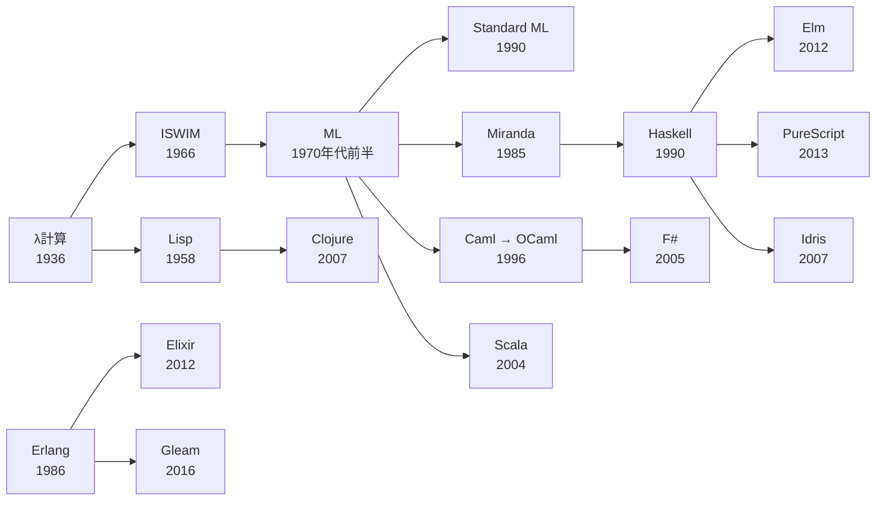

:::message
本記事は、内容の生成に AI を利用しています。
:::

## 導入: 「関数型言語」という括りの曖昧さ

「関数型プログラミング言語」という括りは、実務の会話で広く使われます。しかし、括りが指す対象は一定しません。副作用を型で隔離する純粋な Haskell も、オブジェクト指向と関数型を統合した Scala も、同じ「関数型言語」という語で呼ばれます。純粋性・型付け・評価戦略・実行基盤のどれを取っても、言語ごとに位置取りは大きく異なります。単一の定義で全体を覆う試みは、無理を生みます。

本記事は、言語を 1 つずつ並べるカタログの体裁を取りません。関数型を成り立たせる概念軸で、複数の言語を横断的に読み解きます。第一級関数・型・評価戦略・副作用・不変性・再帰・並行・実行基盤という軸を順に取り上げ、同じ概念を複数言語のコードで比較します。要所では代表的な言語を深く掘り下げます。軸の検討に先立ち、λ計算から現代までの系譜を短く整理します。「関数型言語」という 1 つのカテゴリではなく、複数の軸上の位置取りの集合として全体像を描く方針です。

対象は、今日も現役の言語に絞ります。扱う言語の内訳は次のとおりです。

- 中心に据える言語: Haskell・OCaml・F#・Scala・Clojure・Elixir・Elm。
- 先端の言語: PureScript・Gleam・Idris。
- 対比に使う多パラダイム言語: Rust・JavaScript。Rust は代数的データ型の箇所を中心に取り上げます。JavaScript は高階関数の箇所で登場します。
- 古典: λ計算・Lisp・Standard ML など。独立した実装章を設けず、歴史的系譜としてのみ言及します。

古典と現役言語の対応は 2 章で示します。

本記事は、いずれかの言語で関数・型・再帰を書いた経験を読者に前提とします。コードは各概念の最小例で示します。実用規模の冗長なコードは扱いません。記事中のコードはすべて実行し、出力を実測値と一致させています[^verification]。

## 1. 関数型とは何か——判定の観点

関数型プログラミングを成り立たせる性質は、いくつかの観点に分解できます。主な観点は、第一級関数・高階関数・参照透過性・純粋性・不変性・式指向です。

- 第一級関数（first-class function）: 関数を値として扱い、変数へ束縛し、引数や戻り値にできる性質。
- 高階関数（higher-order function）: 関数を引数に取るか、関数を戻り値に返す関数。
- 参照透過性（referential transparency）: 同じ入力に対して式が常に同じ値を返し、式を値へ置き換えても意味が変わらない性質。
- 純粋性（purity）: 関数が副作用を持たず、参照透過性を保つ性質。
- 不変性（immutability）: 一度作った値を破壊的に変更しない性質。
- 式指向（expression-oriented）: 文（statement）ではなく式（expression）を基本単位とし、制御構造も値を返す設計。

「関数型言語」は、上記の性質をどこまで備えるかで連続的に分布します。関数型言語かどうかを、単一の境界では二分できません。分布は 3 つの帯に大別できます。

- 純粋（pure）: 副作用を型や仕組みで隔離します。Haskell・Elm・PureScript・Idris が該当します。
- 関数型ファースト（functional-first）: 関数型を既定の書き方としつつ、副作用も自由に許します。OCaml・F#・Scala・Clojure・Elixir が該当します。
- 多パラダイムで関数型機能を持つ: 命令型やオブジェクト指向を主としつつ、関数型の機能を備えます。Rust・Kotlin・JavaScript が該当します。

高階関数の最小例で、観点の一端を確認します。整数を 2 倍にする関数を、リストの各要素へ適用します。まず Haskell です。

```haskell:hof.hs
double :: Int -> Int
double x = x * 2

main :: IO ()
main = print (map double [1, 2, 3])
-- 出力: [2,4,6]
```

同じ処理を JavaScript で書きます。配列の `map` メソッドが高階関数です。

```js:hof.js
const double = (x) => x * 2
console.log([1, 2, 3].map(double))
// 出力: [ 2, 4, 6 ]
```

Clojure でも書きます。`map` は関数を第一級の値として受け取ります。関数名は、`clojure.core/double` との衝突を避けて `twice` とします。

```clojure:hof.clj
(defn twice [x] (* x 2))
(println (map twice [1 2 3]))
;; 出力: (2 4 6)
```

同じ処理は、他の関数型言語でも短く書けます。各言語は、リストを写像する高階関数を標準ライブラリで提供します。

:::details 他の言語での記述例
OCaml は `List.map` に関数を渡します。パイプ演算子 `|>` で値を次の関数へ送ります。

```ocaml:hof.ml
let double x = x * 2

let () =
  [ 1; 2; 3 ]
  |> List.map double
  |> List.iter (Printf.printf "%d ")
(* 出力: 2 4 6 *)
```

F# も `List.map` を使い、`|>` でパイプラインを組みます。

```fsharp:hof.fsx
let double x = x * 2
[ 1; 2; 3 ] |> List.map double |> printfn "%A"
// 出力: [2; 4; 6]
```

Scala はコレクションの `.map` メソッドへ関数を渡します。

```scala:hof.scala
@main def run(): Unit =
  val double = (x: Int) => x * 2
  println(List(1, 2, 3).map(double))
// 出力: List(2, 4, 6)
```

Elixir は `Enum.map` に無名関数を渡します。

```elixir:hof.exs
double = fn x -> x * 2 end
IO.inspect(Enum.map([1, 2, 3], double))
# 出力: [2, 4, 6]
```

Elm は `List.map` を使います。対話環境で `List.map (\x -> x * 2) [1, 2, 3]` を評価すると `[2,4,6] : List number` を返します。
:::

高階関数は、関数を引数に取るだけでなく、関数を戻り値に返す形も取ります。引数を 1 つずつ受け取り、残りの引数を待つ関数を返す仕組みをカリー化（currying）と呼びます。部分適用（partial application）は、カリー化された関数へ引数の一部だけを与える操作です。Haskell で 2 引数の加算を部分適用します。

```haskell:curry.hs
add :: Int -> Int -> Int
add x y = x + y

main :: IO ()
main = do
  let add5 = add 5
  print (add5 10)
  print (map add5 [1, 2, 3])
-- 出力:
-- 15
-- [6,7,8]
```

`add 5` は、引数を 1 つだけ適用した関数 `add5` を返します。返された関数は、`map` の引数としてリストの各要素へ適用できます。OCaml と F# は関数を既定でカリー化し、同じ部分適用を書けます。

:::details カリー化の他言語例
OCaml は関数を自動でカリー化します。`add 5` が関数を返します。

```ocaml:curry.ml
let add x y = x + y

let () =
  let add5 = add 5 in
  Printf.printf "%d\n" (add5 10)
(* 出力: 15 *)
```

F# も同じく関数を自動でカリー化します。

```fsharp:curry.fsx
let add x y = x + y
let add5 = add 5
printfn "%d" (add5 10)
// 出力: 15
```
:::

各言語は、構文と実行基盤が異なります。しかし、関数を値として `map` や `Enum.map` へ渡す構造は共通です。高階関数という観点では、静的型付けの Haskell・OCaml・F#・Scala・Elm と、動的型付けの JavaScript・Clojure・Elixir が同じ地平に立ちます。関数型を判定する観点は、言語のカタログ的な分類より細かい粒度で言語を捉えます。

## 2. 系譜——λ計算から現代へ

現役の関数型言語は、単一の源流から枝分かれしたわけではありません。しかし、共通の理論的な祖先を持ちます。ラムダ計算（λ計算）です。Alonzo Church が 1936 年に発表した λ計算は、関数の定義と適用だけで計算を表現する形式体系です[^church-1936]。関数を第一級に扱う発想の源流は、λ計算にあります。λ計算の構文と簡約は付録 A で形式化します。

系譜の主要な流れは、次のとおりです。

- Lisp（1958）: λ計算から生まれ、John McCarthy が記号処理と関数抽象を計算機上で実現しました[^mccarthy-1960]。
- ISWIM（1966）: Peter Landin が式指向の構文と `let` 束縛を導入し、後続の言語の設計に影響を与えました[^landin-1966]。
- ML（1970 年代前半）: Robin Milner を中心とする Edinburgh の研究グループが、LCF 証明支援系のメタ言語として設計しました[^hopl-sml-2020]。後述する Hindley-Milner 型推論を実装した最初の言語族です。

ML からの主な派生は、次のとおりです。

- Standard ML（1990 に定義）: ML 系の直系です[^hopl-sml-2020]。
- OCaml（1996）: Caml から発展した ML 系の直系です[^ocaml-history]。
- Miranda（1985）と Haskell（1990 に最初の言語仕様）: David Turner の Miranda が純粋・遅延評価の設計を先取りし、Haskell へ直接つながります[^haskell-history]。

BEAM 系は、ML とは独立した流れです。

- Erlang（1986）: Ericsson の Joe Armstrong らが開発し、並行と耐障害性を重視する設計を確立しました[^erlang-history]。
- Elixir（2012）と Gleam（2016 年ごろに開発が始まる）: Erlang と同じ実行基盤の上に載ります[^elixir-history][^gleam-history]。

主要な派生関係を図で示します。年号は各言語の初出または最初の公式仕様を示します。



:::message
系譜図は主要な影響関係を単純化したものです。実際の言語設計は、複数の言語から同時に影響を受けます。Scala は ML・Haskell・Java の 3 系統から、Gleam は Erlang の実行基盤と Elm・OCaml・Rust の型システムから影響を受けています[^gleam-history]。図は単一の親子関係を強調しますが、実際は多対多の影響の網です。
:::

古典を系譜としてのみ扱う理由は、記事の狙いにあります。λ計算は理論の基盤であり、実務のコードを書く言語ではありません。Lisp・Standard ML・Miranda は、設計思想を現役の言語へ受け渡した後、実務の主役の座を後継言語へ譲りました。古典と現役言語の対応は次のとおりです。

- Lisp: 現役の方言は Clojure が代表します。
- Standard ML: 現役の ML 系は OCaml と F# が担います。
- Miranda: 純粋・遅延の設計を Haskell が受け継ぎました。

本記事は、古典が確立した概念を軸として取り出し、軸の上で現役の言語を読み解きます。

## 3. 型の軸——静的/動的・型推論・代数的データ型

型の扱いは、関数型言語を分ける最大の軸の 1 つです。軸は、静的型付けと動的型付けの区別、型推論の有無、代数的データ型の表現力という 3 つの観点で捉えられます。

### 静的型付けと動的型付け

型付けのタイミングで、関数型言語は 2 つに分かれます。

- 静的型付け（static typing）: 実行前の型検査でプログラムの型を確定します。Haskell・OCaml・F#・Scala・Elm・PureScript・Gleam・Idris が採用します。
- 動的型付け（dynamic typing）: 実行時に値のタグを検査します。Clojure と Elixir が採用します。

同じ関数型ファーストの帯にありながら、OCaml は静的型付け、Elixir は動的型付けという対照的な位置を占めます。型付けのタイミングは、関数型か否かとは独立した軸です。

### Hindley-Milner 型推論

静的型付けの関数型言語の多くは、型注釈を省いても型が付く型推論を備えます。理論の中核が Hindley-Milner 型推論（以下 HM 型推論）です。J. Roger Hindley が 1969 年にコンビネータ論理の主要型を論じ[^hindley-1969]、Robin Milner が 1978 年に型多相性の理論としてプログラミング言語へ定式化し、推論アルゴリズム W を導入しました[^milner-1978]。Luis Damas と Robin Milner は 1982 年に、アルゴリズム W による主要型の計算について健全性・完全性を証明しました[^damas-milner-1982]。HM 型推論は、注釈なしで最も一般的な型（principal type、主要型）を機械的に導きます。理論の骨格は付録 A で扱います。

OCaml の対話環境で、型推論を確認します。関数を 2 つ合成する `compose` を、型注釈なしで定義します。

```ocaml:inference.ml
let compose f g x = f (g x);;
```

OCaml の対話環境は、定義に対して次の型を表示します。

```text
val compose : ('a -> 'b) -> ('c -> 'a) -> 'c -> 'b = <fun>
```

`'a`・`'b`・`'c` は型変数です。`compose` は、`'c -> 'a` の関数 `g` と `'a -> 'b` の関数 `f` を受け取り、`'c -> 'b` の関数を返します。型注釈を 1 つも書かずに、コンパイラが最も一般的な多相型を導きます。

同じ推論の系譜を、Haskell と F# も共有します。同じ `compose` を型注釈なしで定義すると、両言語も等価な多相型を導きます。

:::details Haskell と F# の型推論
Haskell の対話環境 GHCi で `compose f g x = f (g x)` を定義し、`:t compose` で型を尋ねると、次の型を表示します。

```text
compose :: (t1 -> t2) -> (t3 -> t1) -> t3 -> t2
```

F# の対話環境 `dotnet fsi` で同じ定義を評価すると、次の型を表示します。

```text
val compose: f: ('a -> 'b) -> g: ('c -> 'a) -> x: 'c -> 'b
```

型変数の名前は言語ごとに異なります。しかし、3 言語は同じ構造の多相型を、注釈なしで導きます。
:::

HM 型推論を全面的に採る言語ばかりではありません。Scala と Rust は局所型推論（local type inference）を採ります。式の内部やローカル変数の型は推論しますが、関数の引数と戻り値には型注釈を求めます。総合比較表で Scala と Rust の型推論を「局所推論」と記すのは、推論の範囲が局所にとどまるためです。

### 代数的データ型とパターンマッチ

代数的データ型（algebraic data type、以下 ADT）は、関数型言語のデータモデリングの中核です。ADT は、直積（product、複数の値の組）と直和（sum、択一の場合分け）を組み合わせて型を構成します。直和の各枝は、パターンマッチ（pattern matching）で分解します。図形を表す `Shape` 型を例に、複数の言語で比較します。

Haskell では `data` で定義します。`Circle` は半径 1 つ、`Rectangle` は幅と高さの 2 つを持ちます。

```haskell:adt.hs
data Shape = Circle Double | Rectangle Double Double

area :: Shape -> Double
area (Circle r) = pi * r * r
area (Rectangle w h) = w * h

main :: IO ()
main = do
  print (area (Circle 1.0))
  print (area (Rectangle 2.0 3.0))
-- 出力:
-- 3.141592653589793
-- 6.0
```

`area` は、`Shape` の 2 つの枝を漏れなく分解します。すべての枝を尽くしているかを検査する性質を網羅性検査（exhaustiveness checking）と呼びます。Haskell は `-Wincomplete-patterns` を有効にすると、枝の抜けを警告します。網羅性検査は、直和型に新しい枝を追加したときの修正漏れを、コンパイル時に検出します。

OCaml は `type` で同じ構造を定義します。網羅性検査は既定で働きます。

```ocaml:adt.ml
type shape = Circle of float | Rectangle of float * float

let area = function
  | Circle r -> Float.pi *. r *. r
  | Rectangle (w, h) -> w *. h

let () =
  Printf.printf "%.6f\n" (area (Circle 1.0));
  Printf.printf "%.1f\n" (area (Rectangle (2.0, 3.0)))
(* 出力:
   3.141593
   6.0 *)
```

`Rectangle` の枝を削除すると、OCaml は `Warning 8 [partial-match]: this pattern-matching is not exhaustive.` という警告を出します。網羅性の欠如を、コンパイラが具体的な反例つきで指摘します。

F# は判別共用体（discriminated union）で表します。ML 系の構文を受け継ぎます。

```fsharp:adt.fsx
type Shape =
    | Circle of float
    | Rectangle of float * float

let area shape =
    match shape with
    | Circle r -> System.Math.PI * r * r
    | Rectangle (w, h) -> w * h

printfn "%f" (area (Circle 1.0))
printfn "%f" (area (Rectangle (2.0, 3.0)))
// 出力:
// 3.141593
// 6.000000
```

Scala 3 は `enum` で直和を表します。`match` 式が各ケースを分解します。

```scala:adt.scala
enum Shape:
  case Circle(r: Double)
  case Rectangle(w: Double, h: Double)

def area(s: Shape): Double = s match
  case Shape.Circle(r)       => math.Pi * r * r
  case Shape.Rectangle(w, h) => w * h

@main def run(): Unit =
  println(area(Shape.Circle(1.0)))
  println(area(Shape.Rectangle(2.0, 3.0)))
// 出力:
// 3.141592653589793
// 6.0
```

Elm も同じ直和とパターンマッチを備えます。純粋関数として `area` を定義します。

```elm:Adt.elm
module Adt exposing (..)

type Shape
    = Circle Float
    | Rectangle Float Float

area : Shape -> Float
area shape =
    case shape of
        Circle r ->
            pi * r * r

        Rectangle w h ->
            w * h
```

`Adt.elm` に保存し、Elm の対話環境で `import Adt exposing (..)` を実行します。`area (Circle 1)` を評価すると `3.141592653589793 : Float` を返し、`area (Rectangle 2 3)` は `6 : Float` を返します。Elm も `case` の網羅性を強制し、枝の抜けをコンパイルエラーにします。

Rust は関数型専用の言語ではありません。しかし、ADT と同系統の `enum` とパターンマッチを備えます。

```rust:adt.rs
enum Shape {
    Circle(f64),
    Rectangle(f64, f64),
}

fn area(s: &Shape) -> f64 {
    match s {
        Shape::Circle(r) => std::f64::consts::PI * r * r,
        Shape::Rectangle(w, h) => w * h,
    }
}

fn main() {
    println!("{}", area(&Shape::Circle(1.0)));
    println!("{}", area(&Shape::Rectangle(2.0, 3.0)));
}
// 出力:
// 3.141592653589793
// 6
```

Rust の `match` も網羅性を強制します。ADT・パターンマッチ・網羅性検査という 3 点は、純粋な Haskell から多パラダイムの Rust まで共通の概念軸です。関数型の中核的な機能が、関数型専用でない言語へ波及した具体例です。

ADT とパターンマッチは、先端の言語でも同じ形を取ります。BEAM 上の Gleam と JavaScript へコンパイルする PureScript も、カスタム型と `case` で図形を表せます。

:::details 先端の言語での記述例——Gleam と PureScript
Gleam はカスタム型でバリアントを定義し、`case` で分解します。フィールドにはラベルを付けられます。

```gleam:adt.gleam
import gleam/io
import gleam/float

pub type Shape {
  Circle(radius: Float)
  Rectangle(width: Float, height: Float)
}

pub fn area(shape: Shape) -> Float {
  case shape {
    Circle(radius: r) -> 3.141592653589793 *. r *. r
    Rectangle(width: w, height: h) -> w *. h
  }
}

pub fn main() {
  io.println(float.to_string(area(Circle(1.0))))
  io.println(float.to_string(area(Rectangle(2.0, 3.0))))
}
// 出力:
// 3.141592653589793
// 6.0
```

PureScript は `data` で直和を定義します。Haskell に近い構文を持ちます。

```purescript:Main.purs
module Main where

import Prelude
import Effect (Effect)
import Effect.Console (logShow)

data Shape = Circle Number | Rectangle Number Number

area :: Shape -> Number
area (Circle r) = 3.141592653589793 * r * r
area (Rectangle w h) = w * h

main :: Effect Unit
main = do
  logShow (area (Circle 1.0))
  logShow (area (Rectangle 2.0 3.0))
-- 出力:
-- 3.141592653589793
-- 6.0
```
:::

### 型クラスとモジュール——抽象化の 2 系統

型の抽象化を担う仕組みは、言語系統で分かれます。主な 2 系統は、型クラスとモジュールです。

- 型クラス（type class）: Haskell が採用します。型ごとの実装を `instance` で与え、関数の対象型を制約で絞ります。
- モジュールとファンクタ（functor）: OCaml が採用します。ファンクタはモジュールを受け取りモジュールを返し、抽象化した実装を組み立てます。

Haskell の型クラスで、型ごとに異なる実装を切り替えます。`Describable` は、型を文字列で説明する `describe` を要求します。

```haskell:typeclass.hs
class Describable a where
  describe :: a -> String

data Dog = Dog
data Cat = Cat

instance Describable Dog where
  describe _ = "dog"

instance Describable Cat where
  describe _ = "cat"

main :: IO ()
main = do
  putStrLn (describe Dog)
  putStrLn (describe Cat)
-- 出力:
-- dog
-- cat
```

`describe` は、引数の型に応じて `Dog` 用と `Cat` 用の実装を選びます。型クラスは、型ごとの実装をコンパイル時に解決します。

OCaml はモジュールとファンクタで同じ抽象化を果たします。`Show` シグネチャを満たすモジュールを受け取り、組を文字列化する `Pair` を組み立てます。

```ocaml:functor.ml
module type Show = sig
  type t
  val show : t -> string
end

module ShowInt : Show with type t = int = struct
  type t = int
  let show = string_of_int
end

module Pair (S : Show) = struct
  let show_pair (a, b) = "(" ^ S.show a ^ ", " ^ S.show b ^ ")"
end

module PairInt = Pair (ShowInt)

let () = print_endline (PairInt.show_pair (1, 2))
(* 出力: (1, 2) *)
```

`Pair` はファンクタです。`ShowInt` を渡すと、整数の組を文字列化する `PairInt` を生成します。型クラスとファンクタは、多相コードの再利用という同じ目的を、別の言語機構で果たします。

### 動的型付け言語のパターンマッチ

パターンマッチは、静的型付け言語の専有物ではありません。動的型付けの Elixir は、パターンマッチを言語の中心に据えます。Elixir の `=` は代入ではなく、左辺のパターンと右辺の値を照合するマッチ演算子です。

```elixir:match.exs
{:ok, value} = {:ok, 42}
IO.puts(value)

case {:error, "not found"} do
  {:ok, v} -> IO.puts("ok: #{v}")
  {:error, reason} -> IO.puts("error: #{reason}")
end
# 出力:
# 42
# error: not found
```

`{:ok, value}` というパターンは、右辺のタプルと構造が一致し、`value` に `42` を束縛します。`case` は複数のパターンを順に照合します。静的な網羅性検査は伴いませんが、構造の分解という発想は静的型付け言語の ADT と共通します。パターンマッチは、型付けのタイミングとは独立した概念軸です。

動的型付けの Clojure は、組み込みの ADT と網羅性検査を持ちません。分配束縛（destructuring）や `core.match` ライブラリで、部分的にパターンマッチを表現します。総合比較表で Clojure の ADT を「部分的」と記すのは、組み込みの直和型を欠くためです。

## 4. 評価戦略の軸——正格 vs 遅延

評価戦略（evaluation strategy）は、式をいつ評価するかを定めます。主な区別は、正格評価（strict evaluation）と遅延評価（lazy evaluation）です。正格評価は、値を必要とする前に式を評価します。多数の関数型言語が正格評価を既定とします。OCaml・F#・Scala・Clojure・Elixir・Elm・PureScript・Gleam・Idris が該当します。遅延評価は、値を実際に必要とするまで式の評価を先送りします。Haskell は遅延評価を既定とする代表的な言語です[^haskell-report-lazy]。

遅延評価の利点は、無限に続くデータ構造を扱える点にあります。Haskell で、すべての正の整数を要素とする無限リストを定義し、先頭の一部だけを取り出します。

```haskell:lazy.hs
main :: IO ()
main = do
  print (take 5 (map (* 2) [1 ..]))
  print (take 10 fibs)
  where
    fibs = 0 : 1 : zipWith (+) fibs (tail fibs)
-- 出力:
-- [2,4,6,8,10]
-- [0,1,1,2,3,5,8,13,21,34]
```

`[1 ..]` は 1 から始まる無限リストです。`map (* 2)` は各要素を 2 倍にしますが、遅延評価のため全要素を評価しません。`take 5` が要求する 5 要素だけを評価します。`fibs` は自分自身を参照して定義したフィボナッチ数列の無限リストです。遅延評価は、自己参照する無限の定義を有限のメモリで扱えます。

:::message
遅延評価には落とし穴もあります。評価を先送りした式（サンク、thunk）が大量に積み上がり、メモリを圧迫する現象を space leak（スペースリーク）と呼びます。畳み込みで途中結果を正格に評価しないと、サンクが線形に蓄積します。Haskell は `foldl'` のような正格版の関数や `seq` による強制評価で space leak に対処します。
:::

正格評価を既定とする言語も、明示的な遅延を選べます。各言語は、遅延を表す専用の仕組みを備えます。

- OCaml: `Seq` の遅延列と `lazy` キーワード。
- F#: `seq { }` 式と `Seq` モジュール。
- Clojure: `lazy-seq` と `iterate` による無限シーケンス。
- Scala: `LazyList` の遅延コンス。

Scala の `LazyList` で無限列を定義します。

```scala:lazy.scala
@main def run(): Unit =
  val nats: LazyList[Int] = LazyList.from(1)
  println(nats.map(_ * 2).take(5).toList)

  lazy val fibs: LazyList[BigInt] =
    BigInt(0) #:: BigInt(1) #:: fibs.lazyZip(fibs.tail).map(_ + _)
  println(fibs.take(10).toList)
// 出力:
// List(2, 4, 6, 8, 10)
// List(0, 1, 1, 2, 3, 5, 8, 13, 21, 34)
```

`LazyList.from(1)` は 1 から始まる無限列です。`#::` は遅延コンスであり、後続の評価を先送りします。既定が正格な Scala でも、`LazyList` を選べば Haskell と同じ無限列のパターンを書けます。

OCaml・F#・Clojure も、同じ無限列の先頭 5 要素だけを取り出せます。

:::details 他の言語での記述例
OCaml は `Seq` の遅延列を使います。`Seq.ints 1` が 1 から始まる無限列です。

```ocaml:lazy.ml
let () =
  Seq.ints 1
  |> Seq.map (fun x -> x * 2)
  |> Seq.take 5
  |> Seq.iter (Printf.printf "%d ")
(* 出力: 2 4 6 8 10 *)
```

F# は `Seq.initInfinite` で無限列を作ります。

```fsharp:lazy.fsx
Seq.initInfinite (fun i -> i + 1)
|> Seq.map (fun x -> x * 2)
|> Seq.take 5
|> Seq.toList
|> printfn "%A"
// 出力: [2; 4; 6; 8; 10]
```

Clojure は `iterate` で無限シーケンスを作り、`take` で先頭を取り出します。

```clojure:lazy.clj
(def nats (iterate inc 1))
(println (take 5 (map #(* 2 %) nats)))
;; 出力: (2 4 6 8 10)
```
:::

評価戦略は、言語の既定として固定されるだけでなく、部分的に切り替えられる軸です。

## 5. 副作用の軸——純粋性の管理

副作用（side effect）とは、式の評価が値を返す以外にもたらす作用です。副作用に該当する作用を挙げます。

- 入出力（コンソール・ファイル・ネットワークとのやり取り）。
- 可変状態の変更（変数やデータ構造を破壊的に書き換える作用）。
- 例外の送出（正常な戻り値ではなく制御を中断する作用）。
- 外部環境への依存（時刻や乱数など、呼ぶたびに結果が変わる作用）。
- 非停止（値を返さずに実行が終わらない作用）。

副作用は、1 章で挙げた参照透過性を壊します。同じ入力に同じ値を返す保証が崩れます。式を値へ置き換える推論も成り立たなくなります。影響は次の観点に及びます。

- 推論（コードの挙動を局所的な式だけから追えなくなる）。
- テスト（実行のたびに結果が変わり再現しにくい）。
- 並行実行（可変状態の共有が競合を生む）。
- 評価順序（作用の順序に結果が依存し、評価戦略を選びにくくなる）。

副作用の抑え方で、関数型言語は大きく分かれます。純粋な言語は、副作用を型や仕組みで隔離します。非純粋な関数型言語は、副作用を式の中で自由に許します。

### 純粋な言語による副作用の隔離

Haskell は、副作用を持つ計算を `IO` 型で表します。`IO a` は、実行すると型 `a` の値を生む副作用つき計算を表す型です。純粋な関数と副作用つき計算は、型で区別されます。`do` 記法が `IO` の計算を順に並べます。

```haskell:io.hs
main :: IO ()
main = do
  putStrLn "name?"
  let name = "world"
  putStrLn ("hello, " ++ name)
-- 出力:
-- name?
-- hello, world
```

`putStrLn` は `String -> IO ()` という型を持ちます。戻り値の型 `IO ()` が、標準出力への書き込みという副作用を型の中に閉じ込めます。純粋な関数は `IO` を戻り値に含みません。型を見れば、副作用の有無を判別できます。副作用の管理を支える理論がモナド（monad）です。詳細は付録 B で扱います。

Elm は、The Elm Architecture という設計で副作用を隔離します[^elm-architecture]。プログラムは `Model`（状態）・`update`（状態遷移）・`view`（描画）の 3 要素で構成します。`update` は `Msg -> Model -> (Model, Cmd Msg)` という純粋な関数であり、副作用を直接起こしません。副作用は `Cmd` という値として記述し、実行時システムへ委譲します。副作用を値として表現し、実行を外部へ委ねる構造は、Haskell の `IO` と発想を共有します。

PureScript は、副作用つき計算を `Effect` 型で表します[^purescript-effect]。`Effect a` は、Haskell の `IO a` に対応します。純粋な計算と副作用つき計算を型で区別する方針は、純粋な言語に共通します。

### 非純粋な関数型言語

OCaml・F#・Scala・Clojure・Elixir・Gleam は、副作用を型で隔離しません。副作用は式の中で自由に起こせます。OCaml で可変参照を使う例を示します。

```ocaml:effect.ml
let () =
  let counter = ref 0 in
  counter := !counter + 1;
  counter := !counter + 1;
  Printf.printf "%d\n" !counter
(* 出力: 2 *)
```

`ref 0` は初期値 0 の可変参照を作ります。`:=` は参照の中身を書き換え、`!` は中身を読み出します。`counter` の型は `int ref` であり、副作用の有無は型に現れません。OCaml は関数型ファーストの言語ですが、副作用を型で追跡しません。

F#・Scala・Clojure・Elixir も、可変状態を式の中で直接扱います。各言語は、可変性を表す専用の構文を持ちます。

- F#: `mutable` 束縛と `<-` 代入。
- Scala: `var` の再代入。
- Clojure: `atom` と `swap!`。
- Elixir: `Agent` によるプロセス内の状態。

:::details 他の言語での可変状態
F# は `mutable` を付けた束縛を `<-` で書き換えます。

```fsharp:effect.fsx
let mutable counter = 0
counter <- counter + 1
counter <- counter + 1
printfn "%d" counter
// 出力: 2
```

Scala は `var` を再代入します。

```scala:effect.scala
@main def run(): Unit =
  var counter = 0
  counter += 1
  counter += 1
  println(counter)
// 出力: 2
```

Clojure は `atom` を `swap!` で更新します。可変状態を明示的な参照型に閉じ込めます。

```clojure:effect.clj
(def counter (atom 0))
(swap! counter inc)
(swap! counter inc)
(println @counter)
;; 出力: 2
```

Elixir は `Agent` にプロセス内の状態を持たせます。状態の更新はメッセージで進めます。

```elixir:effect.exs
{:ok, counter} = Agent.start_link(fn -> 0 end)
Agent.update(counter, &(&1 + 1))
Agent.update(counter, &(&1 + 1))
IO.puts(Agent.get(counter, & &1))
# 出力: 2
```
:::

純粋な Haskell との対比が、純粋性の管理という軸を際立たせます。純粋性は、関数型か否かとは独立した軸です。純粋な関数型言語と非純粋な関数型言語は、同じ「関数型」の括りの中で異なる位置を占めます。

## 6. 不変性の軸——永続データ構造

不変性（immutability）は、一度作った値を破壊的に変更しない性質です。関数型言語は、不変性を既定とする設計が主流です。値を変更する代わりに、変更を反映した新しい値を作ります。素朴に実装すると、変更のたびに全体を複製し、性能を損ないます。永続データ構造（persistent data structure）は、複製を避ける仕組みです[^okasaki-1998]。

永続データ構造の中核は、構造共有（structural sharing）です。新しい値は、変更部分だけを新規に作り、変更しない部分を元の構造と共有します。Clojure の永続ハッシュマップとセットは、Hash Array Mapped Trie（以下 HAMT）を基盤とします[^bagwell-2001]。HAMT は、木の一部の経路だけを差し替え、残りの部分木を共有します。Clojure の `assoc` で確認します。

```clojure:persistent.clj
(def m1 {:a 1 :b 2})
(def m2 (assoc m1 :c 3))
(println m1)
(println m2)
;; 出力:
;; {:a 1, :b 2}
;; {:a 1, :b 2, :c 3}
```

`assoc` は、元のマップ `m1` を変更せず、キー `:c` を加えた新しいマップ `m2` を返します。`m1` は `{:a 1, :b 2}` のまま保たれます。`m2` は `m1` と大部分の構造を共有し、変更部分だけを新規に確保します。構造共有により、複製のコストを対数時間に抑えます。

同じ「更新が新しい値を返す」構造は、他の関数型言語の不変マップにも共通します。Scala の不変マップで確認します。

```scala:persistent.scala
@main def run(): Unit =
  val m1 = Map("a" -> 1, "b" -> 2)
  val m2 = m1 + ("c" -> 3)
  println(m1)
  println(m2)
// 出力:
// Map(a -> 1, b -> 2)
// Map(a -> 1, b -> 2, c -> 3)
```

`m1 + ("c" -> 3)` は、元の `m1` を保ったまま新しいマップ `m2` を返します。Haskell・Elixir・F#・OCaml も、更新のたびに元のマップを残して新しいマップを返します。

:::details 他の言語での記述例
Haskell の `Data.Map` は、`insert` で新しいマップを返します。

```haskell:persistent.hs
import qualified Data.Map as Map

main :: IO ()
main = do
  let m1 = Map.fromList [("a", 1), ("b", 2)] :: Map.Map String Int
  let m2 = Map.insert "c" 3 m1
  print m1
  print m2
-- 出力:
-- fromList [("a",1),("b",2)]
-- fromList [("a",1),("b",2),("c",3)]
```

Elixir の `Map.put` も、元のマップを変更せず新しいマップを返します。

```elixir:persistent.exs
m1 = %{a: 1, b: 2}
m2 = Map.put(m1, :c, 3)
IO.inspect(m1)
IO.inspect(m2)
# 出力:
# %{b: 2, a: 1}
# %{c: 3, b: 2, a: 1}
```

F# の `Map.add` は、新しいキーを加えたマップを返します。

```fsharp:persistent.fsx
let m1 = Map.ofList [ ("a", 1); ("b", 2) ]
let m2 = Map.add "c" 3 m1
printfn "%A" m1
printfn "%A" m2
// 出力:
// map [("a", 1); ("b", 2)]
// map [("a", 1); ("b", 2); ("c", 3)]
```

OCaml は `Map.Make` で作ったモジュールの `add` で、新しいマップを返します。

```ocaml:persistent.ml
module StringMap = Map.Make (String)

let show m =
  StringMap.bindings m
  |> List.map (fun (k, v) -> Printf.sprintf "%s=%d" k v)
  |> String.concat ", "

let () =
  let m1 = StringMap.(empty |> add "a" 1 |> add "b" 2) in
  let m2 = StringMap.add "c" 3 m1 in
  print_endline (show m1);
  print_endline (show m2)
(* 出力:
   a=1, b=2
   a=1, b=2, c=3 *)
```

Elixir の出力は、キーを内部表現の順序で表示します。順序は実行ごとに変わることがあります。順序が違っても、`m1` は `a` と `b` を保ち、`m2` だけが `c` を加えます。
:::

不変性は、等価性と並行安全に直接寄与します。値が変わらないため、値の等価性を内容だけで判定できます。複数のスレッドで同じ値を共有しても、書き換えが起きないため競合は発生しません。不変性は、次章以降の再帰と並行の軸を支える基盤です。

## 7. 再帰の軸——パターンマッチと末尾呼び出し

関数型言語は、繰り返しをループではなく再帰で表現します。可変なループ変数を使わず、関数の再帰呼び出しで反復を進めます。素朴な再帰は、呼び出しごとにスタックを消費し、深い再帰でスタック溢れを起こします。対策が末尾呼び出し最適化（tail call optimization、以下 TCO）です。関数の最後の操作が再帰呼び出しであれば、現在のスタックフレームを再利用し、スタックの消費を一定に抑えます。

Elixir で末尾再帰の階乗を書きます。累積値を引数で持ち回り、最後の操作を再帰呼び出しにします。

```elixir:factorial.exs
defmodule Math do
  def factorial(n), do: factorial(n, 1)
  defp factorial(0, acc), do: acc
  defp factorial(n, acc), do: factorial(n - 1, acc * n)
end

IO.puts(Math.factorial(10))
# 出力: 3628800
```

`factorial(n - 1, acc * n)` は関数の最後の操作です。Elixir の実行基盤である BEAM は末尾呼び出しを最適化し、深い再帰でもスタックを一定に保ちます。

同じ末尾再帰の階乗を、OCaml・Scala・Clojure・F# でも書けます。TCO を促す書き方は言語ごとに異なります。

:::details 他の言語での記述例
OCaml は `rec` と `match` で末尾再帰を書きます。

```ocaml:factorial.ml
let factorial n =
  let rec go n acc =
    match n with
    | 0 -> acc
    | n -> go (n - 1) (acc * n)
  in
  go n 1

let () = Printf.printf "%d\n" (factorial 10)
(* 出力: 3628800 *)
```

Scala は `@tailrec` で末尾再帰を明示します。末尾再帰でない場合はコンパイルエラーになります。

```scala:factorial.scala
import scala.annotation.tailrec

@main def run(): Unit =
  @tailrec
  def factorial(n: Int, acc: Int): Int =
    if n == 0 then acc else factorial(n - 1, acc * n)
  println(factorial(10, 1))
// 出力: 3628800
```

Clojure は `loop` と `recur` で末尾位置の再帰をループへ変換します。

```clojure:factorial.clj
(defn factorial [n]
  (loop [n n acc 1]
    (if (zero? n)
      acc
      (recur (dec n) (* acc n)))))
(println (factorial 10))
;; 出力: 3628800
```

F# は `rec` と `match` で書きます。OCaml と同じ構造です。

```fsharp:factorial.fsx
let factorial n =
    let rec go n acc =
        match n with
        | 0 -> acc
        | n -> go (n - 1) (acc * n)
    go n 1

printfn "%d" (factorial 10)
// 出力: 3628800
```
:::

実行基盤は TCO の扱いを左右します。実行基盤ごとに末尾呼び出し最適化の扱いが分かれます。Java 仮想マシン（Java Virtual Machine、以下 JVM）は末尾呼び出しの自動最適化を持ちません。

- BEAM 上の Elixir と Erlang: 末尾呼び出しを基盤の水準で最適化します。
- JVM 上の Scala: 自己末尾再帰を自動でループへ変換します。`@tailrec` は最適化を検証する注釈で、変換できない場合はコンパイルエラーになります。
- JVM 上の Clojure: `recur` という専用の構文で、末尾位置の再帰をループへ変換します。

実行基盤は、再帰の書き方に制約を与える軸です。

高階関数の `map`・`filter`・`fold` も、再帰で定義できます。Haskell で右畳み込み `foldr` を自前で定義し、`map` を `foldr` で表します。

```haskell:fold.hs
myFoldr :: (a -> b -> b) -> b -> [a] -> b
myFoldr _ acc [] = acc
myFoldr f acc (x : xs) = f x (myFoldr f acc xs)

myMap :: (a -> b) -> [a] -> [b]
myMap f = myFoldr (\x acc -> f x : acc) []

main :: IO ()
main = do
  print (myFoldr (+) 0 [1, 2, 3, 4, 5])
  print (myMap (* 2) [1, 2, 3])
-- 出力:
-- 15
-- [2,4,6]
```

`myFoldr` は、空リストで累積値を返し、要素があれば先頭と再帰結果を結合します。`myMap` は `foldr` の上に構築できます。畳み込みは、多くのリスト処理を統一的に表現する基本操作です。再帰とパターンマッチと畳み込みは、関数型のリスト処理を支える相互に結び付いた概念です。

## 8. 並行の軸——関数型との相性

純粋性と不変性は、並行処理と好相性です。共有する値が書き換わらなければ、複数の実行単位が同じ値を安全に読めます。データ競合の主因である可変状態の共有が、そもそも発生しません。関数型言語は、並行モデルの実装で独自の発展を遂げました。

代表的なモデルがアクターモデル（actor model）です。Carl Hewitt が 1973 年に提唱しました[^hewitt-1973]。アクターは、独立した実行単位であり、メッセージの送受信だけで相互作用します。状態を共有せず、メッセージで通信する設計は、不変性の発想と一致します。Erlang と Elixir は、アクターモデルに相当する軽量プロセスを実装します。Elixir で、プロセスを生成しメッセージを送受信します。

```elixir:concurrency.exs
parent = self()

spawn(fn ->
  receive do
    {:ping, from} -> send(from, :pong)
  end
end)
|> send({:ping, parent})

receive do
  :pong -> IO.puts("got pong")
end
# 出力: got pong
```

`spawn` は新しいプロセスを生成します。`send` はメッセージを送り、`receive` はメッセージを待ち受けてパターンで振り分けます。生成したプロセスは `{:ping, from}` を受け取り、送信元へ `:pong` を返します。プロセスは状態を共有せず、メッセージだけで通信します。BEAM は数十万のプロセスを軽量に扱い、耐障害性の高い並行システムを支えます。

アクターモデル以外の並行モデルも、関数型言語は実コードで表せます。3 つの代表的なモデルを、Haskell・Scala・Clojure で示します。

- Haskell: 軽量スレッド `forkIO` と `MVar` による値の受け渡し。
- Scala: `Future` による非同期計算。
- Clojure: `future` と `atom` による並行実行と共有状態。

:::details 他の言語での記述例
Haskell は `forkIO` で軽量スレッドを起動し、`MVar` で値を受け渡します。

```haskell:concurrency.hs
import Control.Concurrent (forkIO)
import Control.Concurrent.MVar

main :: IO ()
main = do
  result <- newEmptyMVar
  _ <- forkIO (putMVar result "pong")
  msg <- takeMVar result
  putStrLn ("got " ++ msg)
-- 出力: got pong
```

Scala は `Future` で非同期計算を表し、`Await` で結果を待ちます。

```scala:concurrency.scala
import scala.concurrent.{Future, Await}
import scala.concurrent.duration.Duration
import scala.concurrent.ExecutionContext.Implicits.global

@main def run(): Unit =
  val f = Future(1 + 2)
  println(Await.result(f, Duration.Inf))
// 出力: 3
```

Clojure は `future` で並行に計算し、`atom` で結果を共有します。

```clojure:concurrency.clj
(def result (atom nil))
(def f (future (reset! result :pong)))
@f
(println @result)
;; 出力: :pong
```
:::

並行の仕組みは、アクターモデルに限りません。Haskell と Clojure は Software Transactional Memory（以下 STM）を備えます[^stm-2005]。STM は、共有メモリへの操作をトランザクションとして扱い、競合時に自動で再試行します。Haskell は加えて、実行時システムが管理する軽量スレッド（green thread）を提供し、OS スレッドより軽量な並行処理を実現します。純粋性と不変性という関数型の基盤が、多様な並行モデルの実装を後押しします。

## 9. 実行基盤の軸

言語の性質は、実行基盤（runtime）に強く規定されます。同じ関数型言語でも、載る基盤が並行モデル・相互運用・エコシステムを決めます。現役の関数型言語は、複数の実行基盤に分散します。

- ネイティブと GHC 実行時システム: Haskell は Glasgow Haskell Compiler（以下 GHC）でネイティブコードへコンパイルし、GHC 実行時システムが軽量スレッドと遅延評価を支えます。
- BEAM: Erlang・Elixir・Gleam は Erlang 仮想マシン BEAM の上で動き、軽量プロセスと耐障害性を共有します。Gleam は JavaScript も出力できます。
- JVM: Scala と Clojure は JVM の上で動き、Java のライブラリ資産と相互運用します。
- .NET: F# は .NET の上で動き、C# のライブラリと相互運用します。
- JavaScript: Elm と PureScript は JavaScript へコンパイルし、ブラウザで動きます。
- WebAssembly: Rust と OCaml は、WebAssembly を出力できます。Rust は wasm32 ターゲットを公式に提供します。OCaml は wasm_of_ocaml を備えます。

実行基盤は、言語の用途を方向づけます。BEAM 上の Elixir は、耐障害性を要する分散システムやサーバーに向きます。JavaScript へコンパイルする Elm は、ブラウザで動くフロントエンドに向きます。JVM 上の Scala は、Java の資産を活かすデータ処理やバックエンドに向きます。言語の設計と実行基盤は、切り離せない一体の選択です。

## 10. 現役言語スナップショット

概念軸で読み解いた内容を、言語ごとの立ち位置としてまとめます。各言語に、特徴的な記述の最小コードと公式サイトへのリンクを添えます。コードはすべて Docker で実行し、出力を実測値と一致させています。

### Haskell

[Haskell](https://www.haskell.org/) は、純粋・遅延評価・型クラスを持つ言語です。GHC でネイティブへコンパイルし、型による副作用の隔離を徹底します。リスト内包表記で、条件を満たす要素だけを変換します。

```haskell:snapshot.hs
main :: IO ()
main = print [x * x | x <- [1 .. 10], even x]
-- 出力: [4,16,36,64,100]
```

`[x * x | x <- [1 .. 10], even x]` は、1 から 10 の偶数だけを 2 乗したリストです。

### OCaml

[OCaml](https://ocaml.org/) は、正格評価の ML 系言語です。高速なネイティブコンパイルとモジュールシステムを持ち、証明系や金融の実装に使われます。レコードとバリアントを組み合わせ、パターンマッチで分解します。

```ocaml:snapshot.ml
type shape =
  | Circle of { radius : float }
  | Rectangle of { width : float; height : float }

let area = function
  | Circle { radius } -> Float.pi *. radius *. radius
  | Rectangle { width; height } -> width *. height

let () =
  Printf.printf "%.4f\n" (area (Circle { radius = 1.0 }));
  Printf.printf "%.1f\n" (area (Rectangle { width = 2.0; height = 3.0 }))
(* 出力:
   3.1416
   6.0 *)
```

バリアントの各枝は名前付きフィールドを持ちます。パターンマッチはフィールドを名前で束縛します。

### F#

[F#](https://fsharp.org/) は、.NET 上の ML 系言語です。OCaml の構文を継承しつつ、.NET のライブラリと相互運用します。`|>` パイプラインとアクティブパターンを備えます。

```fsharp:snapshot.fsx
let (|Even|Odd|) n = if n % 2 = 0 then Even else Odd

let classify n =
    match n with
    | Even -> sprintf "%d:even" n
    | Odd -> sprintf "%d:odd" n

[ 1; 2; 3; 4 ]
|> List.map classify
|> String.concat ", "
|> printfn "%s"
// 出力: 1:odd, 2:even, 3:odd, 4:even
```

`(|Even|Odd|)` はアクティブパターンです。`match` の中で、ユーザー定義のパターンとして使えます。

### Scala

[Scala](https://www.scala-lang.org/) は、JVM 上でオブジェクト指向と関数型を統合する言語です。Scala 3 の `given`/`using` で型クラスを表します。

```scala:snapshot.scala
trait Show[A]:
  def show(a: A): String

given Show[Int] with
  def show(a: Int): String = s"Int($a)"

def describe[A](a: A)(using s: Show[A]): String = s.show(a)

@main def run(): Unit =
  println(describe(42))
// 出力: Int(42)
```

`given` は型ごとの実装を提供します。`using` は実装をコンパイラが暗黙に補います。Haskell の型クラスに対応する仕組みです。

### Clojure

[Clojure](https://clojure.org/) は、JVM 上の現代的な Lisp 方言です。永続データ構造とマクロを備えます。スレッドマクロ `->>` で、`filter`・`map`・`reduce` を連ねます。

```clojure:snapshot.clj
(println (->> (range 1 11)
              (filter even?)
              (map #(* % %))
              (reduce +)))
;; 出力: 220
```

`->>` は、前の式の結果を次の関数の最後の引数へ渡します。処理の流れを上から下へ読み下せます。

### Elixir

[Elixir](https://elixir-lang.org/) は、BEAM 上の動的型付け言語です[^elixir-types]。Erlang の並行モデルと耐障害性を継承します。`with` 式で、連続するパターンマッチを束ねます。

```elixir:snapshot.exs
defmodule Parser do
  def run(a, b) do
    with {x, ""} <- Integer.parse(a),
         {y, ""} <- Integer.parse(b) do
      {:ok, x + y}
    else
      _ -> :error
    end
  end
end

IO.inspect(Parser.run("3", "4"))
IO.inspect(Parser.run("3", "x"))
# 出力:
# {:ok, 7}
# :error
```

`with` は、パターンが一致する限り次の節へ進みます。1 つでも一致しないと `else` へ抜けます。

### Elm

[Elm](https://elm-lang.org/) は、JavaScript へコンパイルする純粋な言語です。徹底した型検査で実行時例外を抑えます。`Maybe` で、失敗しうる計算を安全に連結します。

```elm
Maybe.map2 (+) (String.toInt "3") (String.toInt "4")
-- 対話環境の出力: Just 7 : Maybe Int
```

`String.toInt` は、変換に失敗すると `Nothing` を返します。`Maybe.map2` は、両方が `Just` のときだけ加算します。`String.toInt "x"` を渡すと、結果は `Nothing : Maybe Int` になります。

### PureScript

[PureScript](https://www.purescript.org/) は、Haskell に近い純粋・静的型付けの言語です。JavaScript へコンパイルします。`Effect` の do 記法と型クラスで、副作用を型で管理します[^purescript-effect]。

```purescript:Main.purs
module Main where

import Prelude
import Effect (Effect)
import Effect.Console (log)

class Describable a where
  describe :: a -> String

data Animal = Dog | Cat

instance Describable Animal where
  describe Dog = "dog"
  describe Cat = "cat"

main :: Effect Unit
main = do
  log (describe Dog)
  log (describe Cat)
-- 出力:
-- dog
-- cat
```

`main` の型 `Effect Unit` は、標準出力への副作用を型の中に閉じ込めます。`describe` は、型クラスで型ごとの実装を選びます。

### Gleam

[Gleam](https://gleam.run/) は、BEAM 上の静的型付け言語です。2024 年に 1.0 へ到達しました[^gleam-history]。ラベル付き引数で、呼び出し側の可読性を高めます。

```gleam:snapshot.gleam
import gleam/io
import gleam/int

fn subtract(from a: Int, take b: Int) -> Int {
  a - b
}

pub fn main() {
  io.println(int.to_string(subtract(from: 10, take: 3)))
}
// 出力: 7
```

`from` と `take` はラベルです。`subtract(from: 10, take: 3)` は、引数の意味を呼び出し側で明示します。

### Idris

[Idris](https://www.idris-lang.org/) は、依存型を持つ汎用言語です。型に値を織り込み、証明と実装を統合します。ベクトルの連結は、長さを型のレベルで加算します。

```idris:snapshot.idr
import Data.Vect

append : Vect n a -> Vect m a -> Vect (n + m) a
append xs ys = xs ++ ys

main : IO ()
main = printLn (toList (append [1, 2] [3, 4, 5]))
-- 出力: [1, 2, 3, 4, 5]
```

戻り値の型 `Vect (n + m) a` は、入力の長さ `n` と `m` の和です。長さの計算を型検査が担います。依存型のため、完全な型推論は決定不能です。Idris はトップレベル定義に型注釈を要し、総合比較表では型推論を「要注釈」と記します。依存型の詳細は付録 C で扱います。

### Rust

[Rust](https://www.rust-lang.org/) は、多パラダイム言語です。イテレータの連結で関数型の記述を書けます。`filter`・`map`・`collect` を連ねます。

```rust:snapshot.rs
fn main() {
    let doubled: Vec<i32> = vec![1, 2, 3, 4, 5]
        .iter()
        .filter(|&&n| n % 2 == 1)
        .map(|&n| n * 2)
        .collect();
    println!("{:?}", doubled);
}
// 出力: [2, 6, 10]
```

`.iter().filter().map().collect()` は、奇数を 2 倍にして新しいベクトルへ集めます。Rust のイテレータは、実行時コストのない抽象として関数型の記述を支えます。

## 考察: 「関数型言語」は軸上の位置取りの集合である

概念軸で読み解くと、「関数型言語」は単一のカテゴリではありません。純粋性・型付け・評価戦略・実行基盤という複数の軸の上で、各言語が異なる位置を占める集合です。関数型言語かどうかを単一の境界で二分する試みは、軸の多様性を捨象します。

純粋性と型付けの 2 つの軸で、主要な言語を配置します。

| | 静的型付け | 動的型付け |
| --- | --- | --- |
| 純粋（副作用を隔離） | Haskell・Elm・PureScript・Idris | （該当なし） |
| 非純粋（副作用を自由に許す） | OCaml・F#・Scala・Gleam | Clojure・Elixir |

純粋かつ動的型付けの象限は、事実上の空白です。副作用を仕組みで隔離する設計は、静的な型検査と組み合わせる場合が主流です。動的型付けの Clojure と Elixir は、副作用を型で追跡しません。2 つの軸は独立に見えて、実際の言語は特定の象限へ偏って分布します。

主要な言語を、複数の軸で総合的に比較します。

| 言語 | 型付け | 型推論 | 純粋性 | 評価戦略 | ADT・パターンマッチ | 主な実行基盤 | 代表用途 |
| --- | --- | --- | --- | --- | --- | --- | --- |
| Haskell | 静的 | HM 系 | 純粋 | 遅延 | あり | GHC・ネイティブ | 研究・言語処理系 |
| OCaml | 静的 | HM 系 | 非純粋 | 正格 | あり | ネイティブ | 証明系・金融 |
| F# | 静的 | HM 系 | 非純粋 | 正格 | あり | .NET | データ分析・業務 |
| Scala | 静的 | 局所推論 | 非純粋 | 正格 | あり | JVM | データ処理・基盤 |
| Clojure | 動的 | なし | 非純粋 | 正格 | 部分的 | JVM | Web・データ処理 |
| Elixir | 動的[^elixir-types] | なし | 非純粋 | 正格 | パターンマッチのみ | BEAM | Web・分散システム |
| Elm | 静的 | HM 系 | 純粋 | 正格 | あり | JavaScript | フロントエンド |
| PureScript | 静的 | HM 系 | 純粋 | 正格 | あり | JavaScript | フロントエンド |
| Gleam | 静的 | HM 系 | 非純粋 | 正格 | あり | BEAM | 型安全な BEAM アプリ |
| Idris | 静的 | 要注釈 | 純粋 | 正格 | あり | Chez Scheme | 研究・証明 |
| Rust | 静的 | 局所推論 | 非純粋 | 正格 | あり | ネイティブ | システム・組込 |

Rust は純粋な関数型言語ではありません。しかし、ADT・パターンマッチ・不変性を既定とする設計で、関数型の機能を多く取り込みます。表の中で Rust は、多パラダイム言語が関数型機能を吸収した例として位置します。

関数型「言語」でなくても、関数型「機能」は実務の主流言語へ広く波及しました。主流言語は、ADT やパターンマッチを言語仕様へ取り込んでいます。

- [TypeScript](https://www.typescriptlang.org/): 合併型（union type）とタグ付き共用体で直和に相当する表現を持ちます。
- Rust: `enum` が ADT そのものです。
- [Kotlin](https://kotlinlang.org/): 直和に相当する `sealed class` を備えます。
- [Swift](https://www.swift.org/): 連想値を持つ `enum` を備えます。
- C# と Java: レコードとパターンマッチを言語仕様へ取り込みました。

関数型の概念軸は、特定の言語群の専有物ではありません。第一級関数・不変性・ADT・パターンマッチは、言語のパラダイムを越えて共通の語彙になりつつあります。

## まとめ

「関数型言語」という括りは、単一の定義で覆えません。第一級関数・型・評価戦略・副作用・不変性・再帰・並行・実行基盤という概念軸で読み解くと、各言語は軸上の異なる位置を占める集合として立ち現れます。Haskell は純粋・遅延・静的型付けの極に立ち、Elixir は非純粋・正格・動的型付けの位置を占めます。同じ「関数型」の括りの中で、両者は複数の軸で対照的です。

概念軸は、言語名の一覧では捉えられない共通の構造を明らかにします。高階関数・ADT・パターンマッチ・不変性・再帰といった軸は、純粋な言語から多パラダイム言語まで横断します。軸で読み解く視点は、個々の言語の理解を、言語を越えた概念の理解へ引き上げます。関数型の機能が主流言語へ広く行き渡った今、二分の問いは有効性を失います。言語の性質は、どの軸のどの位置に立つかという問いで、より精密に捉えられます。

## 付録

### 付録 A: λ計算と Hindley-Milner の骨格

λ計算は、関数の定義と適用だけで計算を表現する形式体系です[^church-1936]。項（term）は、次の文法で定義します。

$$
t ::= x \mid \lambda x.\ t \mid t_1\ t_2
$$

$x$ は変数です。$\lambda x.\ t$ は、引数 $x$ を取り本体 $t$ を返す関数（ラムダ抽象）です。$t_1\ t_2$ は、関数 $t_1$ に引数 $t_2$ を適用する関数適用です。計算の中核は、β簡約（beta reduction）です。

$$
(\lambda x.\ t)\ v \to [x \mapsto v]\ t
$$

$(\lambda x.\ t)\ v$ は、関数 $\lambda x.\ t$ に引数 $v$ を適用した項です。β簡約は、本体 $t$ の中の変数 $x$ を、すべて引数 $v$ で置き換えます。$[x \mapsto v]\ t$ は、置き換えの結果を表します。関数適用を置換で計算する規則が、λ計算の計算原理です。

HM 型推論は、λ計算に多相型を与える体系です[^milner-1978][^damas-milner-1982]。中核のアイデアは 2 つです。第 1 に、注釈なしの項へ最も一般的な型（principal type、主要型）を割り当てます。第 2 に、型を単一化（unification）で決定します。単一化は、2 つの型を等しくする型変数の割り当てを求める操作です。

型 $\tau$ は、次の文法で定義します。

$$
\tau ::= \alpha \mid \tau_1 \to \tau_2
$$

$\alpha$ は型変数です。$\tau_1 \to \tau_2$ は関数型です。λ計算の項に型を割り当てる規則の詳細は、TAPL の第 5 章と第 22 章を参照します[^church-lambda]。推論アルゴリズム W は、項を走査しながら型変数を導入し、関数適用のたびに引数の型と仮引数の型を単一化します。関数 `compose` に注釈なしで多相型が付く理由は、アルゴリズム W が型変数を導入し、矛盾しない最も一般的な型を単一化で導くためです。let 束縛では型変数を全称量化し、多相性を保ちます。let 多相（let-polymorphism）と呼びます。

### 付録 B: モナドと圏論的背景

モナド（monad）は、副作用つき計算を合成する仕組みです。理論の起源は、Eugenio Moggi が 1991 年に示した計算のモナド的な意味論です[^moggi-1991]。Philip Wadler が、モナドを関数型プログラミングの構造として広めました[^wadler-1992]。Haskell は、モナドを型クラスの階層で表します。

- Functor: 値を包む文脈の上で関数を適用する `fmap` を持ちます。
- Applicative: 包まれた関数を包まれた値へ適用する `<*>` と、値を包む `pure` を持ちます。
- Monad: 計算を連結する `>>=`（bind）を持ちます。

Haskell の `Maybe` モナドで、失敗しうる計算を連結します。

```haskell:monad.hs
safeDiv :: Int -> Int -> Maybe Int
safeDiv _ 0 = Nothing
safeDiv x y = Just (x `div` y)

main :: IO ()
main = do
  print (Just 100 >>= safeDiv 200 >>= safeDiv 300)
  print (Just 0 >>= safeDiv 200 >>= safeDiv 300)
-- 出力:
-- Just 150
-- Nothing
```

`>>=` は、`Maybe` の値を次の計算へ渡します。1 行目は `safeDiv 200 100` が `Just 2` を返し、続く `safeDiv 300 2` が `Just 150` を返します。途中で `Nothing` が生じると、後続の計算を飛ばして `Nothing` を返します。2 行目は `safeDiv 200 0` が `Nothing` を返し、後続の `safeDiv 300` を短絡します。副作用や失敗の連結を、`>>=` が一様に扱います。

モナドは、3 つの法則（モナド則）を満たします。`return` は値を最小の文脈へ包む操作です。

```haskell
-- 左単位元: return a >>= f と f a は等しい
-- 右単位元: m >>= return と m は等しい
-- 結合律: (m >>= f) >>= g と m >>= (\x -> f x >>= g) は等しい
```

`IO` モナドは、副作用つき計算をモナドの枠組みで扱う具体例です。`IO a` は、実行時に副作用を起こして型 `a` の値を生む計算です。`do` 記法は `>>=` の連鎖の構文糖であり、副作用つき計算を手続き的な見た目で並べます。モナドは、純粋な言語が副作用を型の中で管理するための数学的な土台です。

### 付録 C: Curry-Howard 対応と依存型

型システムは、論理学と対応関係を持ちます。型を命題とみなし、型を持つ項を命題の証明とみなす対応です。Curry-Howard 対応（Curry-Howard correspondence）と呼びます[^wadler-2015]。関数型 $A \to B$ は含意 $A \Rightarrow B$ に、直積型 $A \times B$ は連言 $A \land B$ に、直和型 $A + B$ は選言 $A \lor B$ に対応します。プログラムを書くことは、対応する命題の証明を構成することと一致します。

依存型（dependent type）は、対応を推し進めた型システムです。型が値に依存できます。長さを型に織り込んだベクトルや、大小関係を型で表す証明を、型として書けます。Idris・Agda・Lean が依存型を備えます[^idris-book]。Idris で、要素数を型に持つベクトルを定義します。

```idris:vect.idr
import Data.Vect

twoInts : Vect 2 Int
twoInts = [1, 2]

threeInts : Vect 3 Int
threeInts = 0 :: twoInts

main : IO ()
main = printLn (toList threeInts)
-- 出力: [0, 1, 2]
```

`Vect 2 Int` は、要素数 2 の `Int` ベクトルの型です。要素数を型に含むため、`0 :: twoInts` は `Vect 3 Int` になります。要素数の異なるベクトルは異なる型を持ち、長さの不一致をコンパイル時に検出できます。依存型は、Curry-Howard 対応を文字どおり実現し、証明と実装を同じ言語で統合します。Lean のような定理証明系は、依存型の上に数学の定理証明を構築します。関数型言語の型は、工学的な安全性の道具であると同時に、論理学と数学に接続する概念です。

[^verification]: 記事中のコードは Docker で実行し、出力を確認しました。使用した処理系は次のとおりです。Haskell は `haskell:9`（GHC 9.14.1）。OCaml は `ocaml/opam:debian-ocaml-5.2`（OCaml 5.2.1）。F# は `mcr.microsoft.com/dotnet/sdk:9.0`（.NET SDK 9.0.315 の `dotnet fsi`）。Scala は `virtuslab/scala-cli`（Scala 3.8.4）。Clojure は `clojure:temurin-21-tools-deps`（Clojure 1.12.5）。Elixir は `elixir:alpine`（Elixir 1.20.1、Erlang/OTP 29）。Elm は Debian ベースの Node イメージ上の Elm 0.19.1。Rust は `rust:1`（rustc 1.96.1）。JavaScript は `node:alpine`（Node.js 26.4.0）。Idris は `vipo/idris2:0.8.0-1`（Idris 2 バージョン 0.8.0）。Gleam は `ghcr.io/gleam-lang/gleam:v1.14.0-erlang-alpine`（Gleam 1.14.0）。PureScript は Debian ベースの Node イメージ上の PureScript 0.15.16 と spago 1.0.4（package set 77.10.1）。
[^church-1936]: Alonzo Church, "An Unsolvable Problem of Elementary Number Theory"。掲載誌は *American Journal of Mathematics* Vol. 58 No. 2、pp. 345–363（1936 年）。λ計算を用いて決定不能な問題を示した論文。<https://doi.org/10.2307/2371045>
[^mccarthy-1960]: John McCarthy, "Recursive Functions of Symbolic Expressions and Their Computation by Machine, Part I"。掲載誌は *Communications of the ACM* Vol. 3 No. 4、pp. 184–195（1960 年）。Lisp の設計を記す論文。<https://doi.org/10.1145/367177.367199>
[^landin-1966]: Peter J. Landin, "The Next 700 Programming Languages"。掲載誌は *Communications of the ACM* Vol. 9 No. 3、pp. 157–166（1966 年）。ISWIM を提示した論文。<https://doi.org/10.1145/365230.365257>
[^hopl-sml-2020]: David MacQueen, Robert Harper, John Reppy, "The History of Standard ML"。掲載誌は *Proc. ACM Program. Lang.* Vol. 4, No. HOPL, Article 86（2020 年 6 月）。ML が Robin Milner と Edinburgh の研究グループによる LCF 証明支援系のメタ言語から発展した経緯と、Standard ML・OCaml を含む言語族への展開を記す。<https://doi.org/10.1145/3386336>
[^ocaml-history]: "About OCaml"（OCaml 公式サイト）。Caml から OCaml への発展と Objective Caml のリリース（1996 年）を記す。<https://ocaml.org/about>
[^haskell-history]: Paul Hudak, John Hughes, Simon Peyton Jones, Philip Wadler による "A History of Haskell: Being Lazy with Class"。*Proceedings of the Third ACM SIGPLAN Conference on History of Programming Languages (HOPL III)*（2007 年）。Haskell の最初の言語仕様（1990 年）と Miranda からの影響を記す。<https://doi.org/10.1145/1238844.1238856>
[^erlang-history]: Joe Armstrong, "A History of Erlang"。*Proceedings of the Third ACM SIGPLAN Conference on History of Programming Languages (HOPL III)*（2007 年）。Erlang の開発（1986 年ごろ）と並行・耐障害性の設計を記す。<https://doi.org/10.1145/1238844.1238850>
[^elixir-history]: "Development"（Elixir 公式サイト）。José Valim が 2012 年に Elixir を作ったことを記す。<https://elixir-lang.org/development.html>
[^elixir-types]: Elixir は実行時に動的型付けです。バージョン 1.20（2026 年）は、集合論的型に基づく型検査をコンパイル時へ段階的に導入しています。<https://elixir-lang.org/blog/2026/06/03/elixir-v1-20-0-released/>
[^gleam-history]: "Gleam version 1.0.0 released"（Gleam 公式ブログ、2024 年 3 月 4 日）。Gleam が BEAM を対象とし 2024 年に 1.0 へ到達したことと、型システムが Elm・OCaml・Rust に着想を得たことを記す。<https://gleam.run/news/gleam-version-1/>
[^church-lambda]: 付録 A の β簡約と型付けの詳細は、Benjamin C. Pierce, 『Types and Programming Languages』（MIT Press、2002 年）第 5 章・第 22 章を参照。<https://www.cis.upenn.edu/~bcpierce/tapl/>
[^hindley-1969]: J. Roger Hindley, "The Principal Type-Scheme of an Object in Combinatory Logic"。掲載誌は *Transactions of the American Mathematical Society* Vol. 146、pp. 29–60（1969 年）。<https://doi.org/10.2307/1995158>
[^milner-1978]: Robin Milner, "A Theory of Type Polymorphism in Programming"。掲載誌は *Journal of Computer and System Sciences* Vol. 17 No. 3、pp. 348–375（1978 年）。Hindley-Milner 型推論の定式化とともに、推論アルゴリズム W を導入した論文。<https://doi.org/10.1016/0022-0000(78)90014-4>
[^damas-milner-1982]: Luis Damas, Robin Milner, "Principal Type-Schemes for Functional Programs"。*Proceedings of the 9th ACM SIGPLAN-SIGACT Symposium on Principles of Programming Languages (POPL '82)*、pp. 207–212（1982 年）。アルゴリズム W による主要型の計算について、健全性・完全性を証明した論文。<https://doi.org/10.1145/582153.582176>
[^haskell-report-lazy]: Simon Marlow (ed.), "Haskell 2010 Language Report"。Haskell が非正格（遅延）評価を既定とすることを記す。<https://www.haskell.org/onlinereport/haskell2010/>
[^okasaki-1998]: Chris Okasaki, 『Purely Functional Data Structures』（Cambridge University Press、1998 年、ISBN 0-521-63124-6）。永続データ構造と構造共有を体系的に論じる。
[^bagwell-2001]: Phil Bagwell, "Ideal Hash Trees"（EPFL Technical Report、2001 年）。Clojure の永続コレクションが基盤とする Hash Array Mapped Trie の原論文。<https://lampwww.epfl.ch/papers/idealhashtrees.pdf>
[^elm-architecture]: "The Elm Architecture"（Elm 公式ガイド）。Model・update・view による副作用の隔離を記す。<https://guide.elm-lang.org/architecture/>
[^purescript-effect]: "The Effect Monad"（PureScript by Example）。副作用つき計算を表す `Effect` 型を記す。<https://book.purescript.org/chapter8.html>
[^hewitt-1973]: Carl Hewitt, Peter Bishop, Richard Steiger, "A Universal Modular ACTOR Formalism for Artificial Intelligence"。*Proceedings of the 3rd International Joint Conference on Artificial Intelligence (IJCAI '73)*、pp. 235–245（1973 年）。アクターモデルを提唱した論文。<https://dl.acm.org/doi/10.5555/1624775.1624804>
[^stm-2005]: Tim Harris, Simon Marlow, Simon Peyton Jones, Maurice Herlihy による "Composable Memory Transactions"。*Proceedings of the 10th ACM SIGPLAN Symposium on Principles and Practice of Parallel Programming (PPoPP '05)*、pp. 48–60（2005 年）。Haskell の Software Transactional Memory を記す論文。<https://doi.org/10.1145/1065944.1065952>
[^moggi-1991]: Eugenio Moggi, "Notions of Computation and Monads"。掲載誌は *Information and Computation* Vol. 93 No. 1、pp. 55–92（1991 年）。計算のモナド的な意味論を示した論文。<https://doi.org/10.1016/0890-5401(91)90052-4>
[^wadler-1992]: Philip Wadler, "The Essence of Functional Programming"。*Proceedings of the 19th ACM SIGPLAN-SIGACT Symposium on Principles of Programming Languages (POPL '92)*、pp. 1–14（1992 年）。モナドを関数型プログラミングの構造として提示した論文。<https://doi.org/10.1145/143165.143169>
[^wadler-2015]: Philip Wadler, "Propositions as Types"。掲載誌は *Communications of the ACM* Vol. 58 No. 12、pp. 75–84（2015 年 12 月）。Curry-Howard 対応の現代的な解説。<https://doi.org/10.1145/2699407>
[^idris-book]: Edwin Brady, 『Type-Driven Development with Idris』（Manning、2017 年、ISBN 978-1-617293-02-3）。Idris と依存型による開発を論じる。<https://www.manning.com/books/type-driven-development-with-idris>
